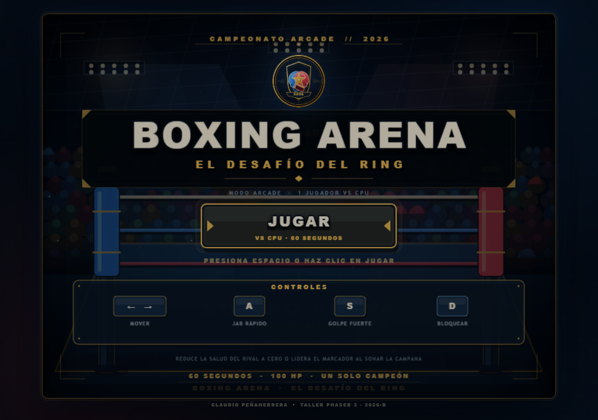
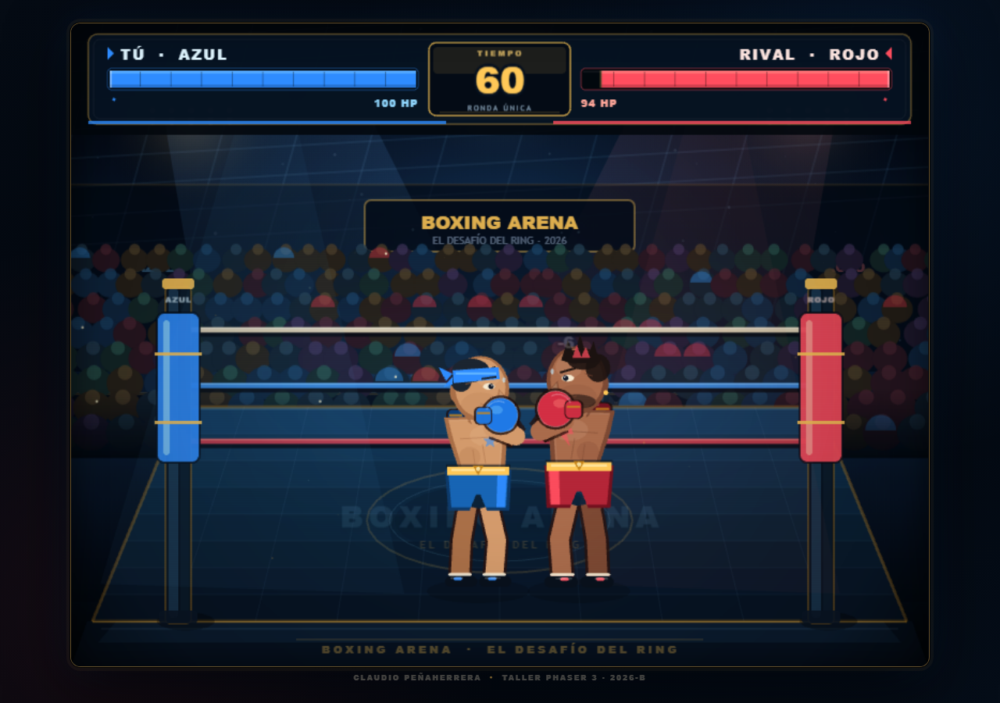
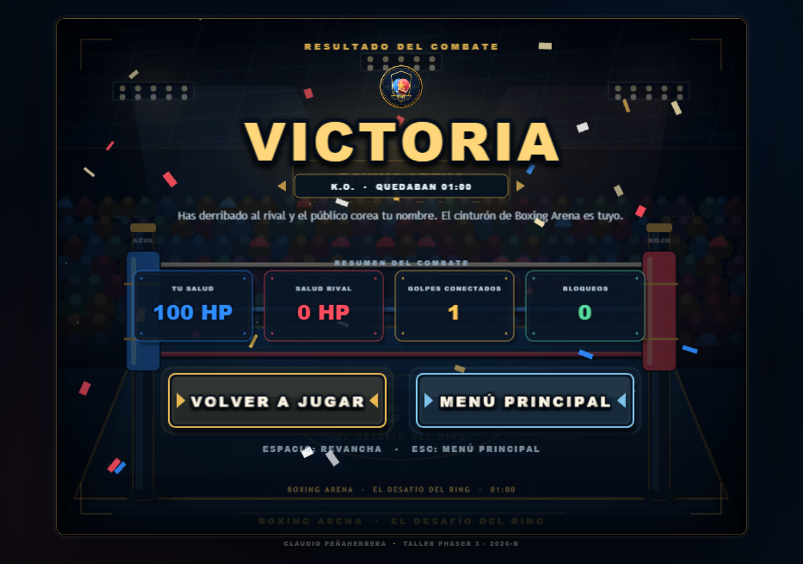

# BOXING ARENA · El Desafío del Ring

**Videojuego arcade de boxeo 2D** desarrollado con **Phaser 3**, HTML5, CSS3 y JavaScript.
Combate contra una IA en una sola ronda de 60 segundos, con golpes rápidos y fuertes,
bloqueo, daño por impacto y resolución por K.O., tiempo o decisión.

**Autor:** Claudio Peñaherrera  
**Taller:** Setup, Desarrollo y Despliegue con Phaser 3  
**Periodo académico:** 2026-B

---

## Descripción

**Boxing Arena** es un juego completo de boxeo arcade para un jugador. El jugador controla
al boxeador **Azul** y se enfrenta al rival **Rojo** en un ring nocturno ambientado con
público, luces, cuerdas y efectos visuales.

El objetivo del taller es aplicar el flujo de trabajo de Phaser 3 de principio a fin:
escenas, ciclo `preload()` / `create()` / `update()`, física Arcade, entrada por teclado,
interfaz de juego, inteligencia artificial, limpieza de recursos y despliegue estático sin
backend ni proceso de compilación.

Todo el arte del escenario, los boxeadores, los efectos y la interfaz se genera en tiempo
real con **Phaser Graphics** y **texturas Canvas**. El juego no necesita imágenes remotas.

---

## Vista previa

| Menú principal | Combate |
| :---: | :---: |
|  |  |

| Resultado del combate |
| :---: |
|  |

---

## Demo

La URL prevista al activar GitHub Pages para este repositorio es:

**https://2026b-sof-jueg-gr3.github.io/penaherrera-claudio-jueg-gr3/**

> La página debe publicarse siguiendo los pasos de la sección
> [Publicación en GitHub Pages](#publicación-en-github-pages).

---

## Características principales

- **Tres escenas independientes:** menú principal, combate y resultado.
- **Combate completo:** salud de 100 HP, temporizador de 60 segundos, K.O., victoria por
  tiempo, derrota y empate.
- **Sistema de golpes con ventanas de impacto:** cada ataque tiene preparación, alcance,
  ventana activa, recuperación y un único impacto por golpe.
- **Dos golpes diferenciados:**
  - **A · JAB rápido:** 6 de daño, menor alcance y recuperación corta.
  - **S · CRUZADO fuerte:** 13 de daño, mayor alcance y recuperación larga.
- **Bloqueo con reducción de daño:** la guardia reduce el daño al 25 % y muestra un efecto
  de impacto defensivo.
- **IA rival con comportamiento variado:** se acerca, mantiene la distancia, retrocede,
  bloquea golpes inminentes y ataca con pausas de recuperación.
- **HUD profesional:** barras de salud azul y roja, estela de daño reciente, contador de HP,
  temporizador central y aviso de últimos segundos.
- **Efectos visuales:** sacudida de cámara, destellos, chispas, números de daño, guardia
  iluminada, polvo ambiental, luces y confeti en la pantalla de resultado.
- **Resumen de combate:** salud final, golpes conectados, bloqueos y tiempo restante.
- **Revancha y regreso al menú** con teclado o botones.
- **Diseño responsivo:** el canvas 800 × 600 se adapta al tamaño de la ventana manteniendo
  la proporción 4:3.
- **Accesibilidad básica:** etiquetas ARIA, texto de ayuda para lectores de pantalla,
  mensaje de error visible y foco de teclado controlado.
- **Funcionamiento sin CDN:** se incluye una copia local de Phaser 3.90.0 como respaldo.

---

## Controles

| Tecla | Acción |
| :---: | --- |
| `←` / `→` | Mover al boxeador |
| `A` | Jab rápido |
| `S` | Golpe fuerte / cruzado |
| `D` | Mantener la guardia y bloquear |
| `ESPACIO` | Iniciar el combate, revancha o reinicio |
| `ENTER` | Alternativa para iniciar o revancha |
| `ESC` | Volver al menú desde la pantalla de resultado |

También se puede iniciar el juego y navegar por los botones con el ratón.

Las flechas y `ESPACIO` quedan capturados por Phaser, de modo que no desplazan la página
mientras se juega.

---

## Reglas del combate

1. Cada boxeador comienza con **100 HP**.
2. La ronda dura **60 segundos**.
3. El combate termina antes si la salud de un boxeador llega a **0**: victoria por **K.O.**
4. Si el tiempo termina, gana quien tenga más salud.
5. Si la salud es igual al agotarse el tiempo, el combate termina en **empate**.
6. Mientras se bloquea con `D` no se puede atacar y el movimiento se detiene.
7. Cada ataque solo puede conectar una vez, aunque la tecla permanezca pulsada.

---

## Tecnologías

| Tecnología | Uso |
| --- | --- |
| **Phaser 3.90.0** | Motor de juego, escenas, entrada, tweens y cámara |
| **Phaser Arcade Physics** | Cuerpos, colisiones y movimiento horizontal |
| **HTML5 Canvas / WebGL** | Renderizado del juego |
| **JavaScript ES6+** | Lógica, clases, IA y utilidades |
| **CSS3** | Marco arcade, fondo, carga y adaptación responsiva |
| **SVG** | Emblema y favicon locales |
| **GitHub Pages** | Publicación estática prevista |

**Restricciones respetadas:** sin frameworks adicionales, sin backend, sin npm, sin proceso
de build y sin imágenes remotas.

---

## Arquitectura del proyecto

La lógica está organizada en `game.js` dentro de una función autoejecutable:

- **Constantes configurables:** dimensiones, colores, límites del ring, salud, duración,
  velocidades, daño, alcance, tiempos de golpe y multiplicador de bloqueo.
- **Utilidades:** textos, paneles, botones, texturas generadas y efectos.
- **Clase `Boxer`:** cuerpo físico invisible, representación vectorial, poses, ataques,
  daño, bloqueo, K.O. y estadísticas.
- **`MenuScene`:** presentación, controles, emblema y acceso al combate.
- **`FightScene`:** combate, controles, IA, colisiones, HUD, temporizador y resolución.
- **`ResultScene`:** resultado, estadísticas, revancha y regreso al menú.
- **Limpieza:** las escenas detienen tweens y eventos temporizados al cerrarse.

El canvas lógico mide **800 × 600** y se escala con `Phaser.Scale.FIT` y
`CENTER_BOTH`.

---

## Estructura del proyecto

```text
penaherrera-claudio-jueg-gr3/
├── index.html                  # Contenedor del juego, carga de Phaser y respaldo local
├── game.js                     # Constantes, escenas, boxeadores, IA y combate
├── style.css                   # Marco arcade, fondo, carga y diseño responsivo
├── README.md
└── assets/
    ├── favicon.svg             # Icono de la pestaña
    ├── ring-logo.svg           # Emblema cargado con preload()
    ├── preview-menu.png        # Captura para la documentación
    ├── preview-fight.png
    ├── preview-result.png
    ├── README.md               # Descripción de los recursos gráficos
    └── vendor/
        ├── phaser-3.90.0.min.js
        └── PHASER-LICENSE.md
```

---

## Ejecución local

Se recomienda servir la carpeta con un servidor HTTP local. Abrir `index.html` directamente
con `file://` puede impedir la carga de recursos en algunos navegadores.

### Opción 1: Live Server (VS Code)

1. Abrir la carpeta del proyecto en Visual Studio Code.
2. Instalar la extensión **Live Server**.
3. Hacer clic derecho sobre `index.html` y elegir **Open with Live Server**.
4. Abrir la dirección indicada por la extensión, normalmente
   `http://127.0.0.1:5500/`.

### Opción 2: servidor de Python

Desde la carpeta del proyecto:

```bash
python -m http.server 5500
```

Después abrir:

```text
http://localhost:5500/
```

### Comprobación rápida

```bash
node --check game.js
```

---

## Verificación realizada

Durante el desarrollo se comprobó el juego en **Microsoft Edge (Chromium) en modo headless**
con un servidor estático local y Playwright. Se ejecutaron **41 verificaciones automatizadas**
y capturas de pantalla en escritorio y móvil.

Comprobaciones principales:

- Carga del menú, versión de Phaser, canvas de 800 × 600 y física Arcade sin gravedad.
- Inicio del combate con `ESPACIO` y botón **JUGAR**.
- Movimiento con flechas y límites izquierdo/derecho del ring.
- Golpe rápido, golpe fuerte, alcance, daño exacto y un solo impacto por ataque.
- Bloqueo con `D`, reducción de daño de 13 a 3 y bloqueo de ataques mientras se defiende.
- IA que se acerca, ataca y muestra animaciones de ataque.
- Fin por tiempo, empate, K.O. y datos del resumen.
- Revancha con `ESPACIO`, regreso al menú con `ESC` y ausencia de escenas duplicadas.
- Diseño móvil a 390 × 844 sin desbordamiento horizontal.
- Carga con el CDN bloqueado usando la copia local de Phaser 3.90.0.
- Ausencia de errores de JavaScript durante las sesiones de prueba.

Los scripts de prueba se ejecutaron fuera del repositorio y no forman parte del paquete
publicado.

---

## Publicación en GitHub Pages

El repositorio remoto configurado es:

```text
https://github.com/2026B-Sof-Jueg-Gr3/penaherrera-claudio-jueg-gr3.git
```

### 1. Confirmar y subir los archivos

```bash
git status
git add .
git commit -m "feat: Boxing Arena completo con Phaser 3"
git branch -M main
git push -u origin main
```

### 2. Activar Pages

1. Entrar al repositorio en GitHub.
2. Abrir **Settings → Pages**.
3. En **Build and deployment**, elegir **Deploy from a branch**.
4. Seleccionar la rama `main`.
5. Seleccionar la carpeta `/ (root)`.
6. Guardar los cambios.

GitHub publicará `index.html` como página principal. La dirección prevista es:

```text
https://2026b-sof-jueg-gr3.github.io/penaherrera-claudio-jueg-gr3/
```

La primera publicación puede tardar unos minutos. Todas las rutas del juego son relativas,
por lo que funcionan dentro de la subcarpeta del repositorio.

---

## Recursos y licencias

- **Phaser 3.90.0** se distribuye bajo licencia MIT. La licencia se incluye en
  `assets/vendor/PHASER-LICENSE.md`.
- El emblema, el favicon, los boxeadores y el escenario fueron creados para este proyecto.
  El arte de juego se genera en tiempo de ejecución y no depende de recursos externos.
- No se utilizan personajes, logotipos ni imágenes protegidas por derechos de autor.

---

## Alcance y limitaciones

- El juego está diseñado para teclado. La interfaz se adapta a móvil, pero no incluye
  controles táctiles.
- No se incluyeron efectos de sonido ni música para mantener el proyecto liviano y sin
  recursos externos.
- Las pruebas de navegador se realizaron en Edge/Chromium; no se verificaron Safari ni
  Firefox.
- La IA usa decisiones aleatorias con pausas, por lo que cada combate puede variar.

---

## Autor

**Claudio Peñaherrera**  
Taller **Setup, Desarrollo y Despliegue con Phaser 3** · 2026-B

Proyecto académico desarrollado con Phaser 3 y tecnologías web estándar.
